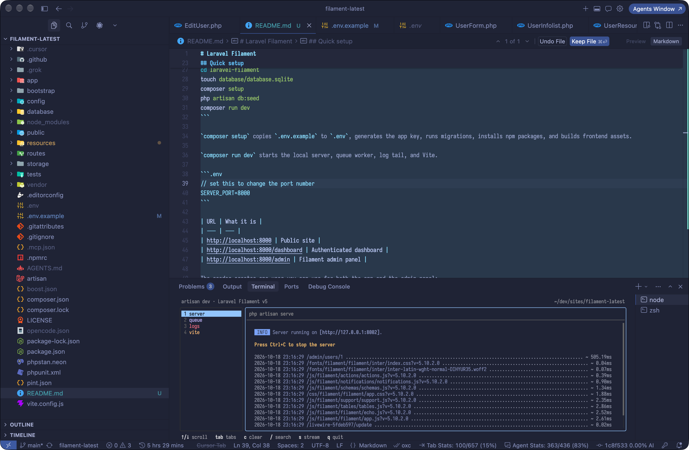

# Laravel Filament

A Laravel application with a [Filament](https://filamentphp.com) admin panel and a [Livewire](https://livewire.laravel.com) frontend. Authentication is handled by [Laravel Fortify](https://laravel.com/docs/fortify), including registration, password reset, email verification, two-factor authentication, and passkeys.



## Stack

| | |
| --- | --- |
| PHP | 8.3+ (8.5 in CI) |
| Laravel | 13 |
| Admin | Filament 5 |
| Frontend | Livewire 4, Flux, Tailwind CSS 4, Vite+ |
| Auth | Fortify |
| Tests | Pest |
| Database | SQLite by default |

## Requirements

- PHP 8.3 or newer, with the usual Laravel extensions (`mbstring`, `openssl`, `pdo_sqlite`, `tokenizer`, `xml`, `ctype`, `bcmath`)
- [Composer](https://getcomposer.org)
- Node.js 22 and npm

## Quick setup

```bash
git clone git@github.com:syntaxlexx/laravel-filament.git
cd laravel-filament
touch database/database.sqlite
composer setup
php artisan db:seed
composer run dev
```

`composer setup` copies `.env.example` to `.env`, generates the app key, runs migrations, installs npm packages, and builds frontend assets.

`composer run dev` starts the local server, queue worker, log tail, and Vite+.

```.env
// set this to change the port number
SERVER_PORT=8000
```

#### Frontend Bundling

CSS and JavaScript are bundled with [Vite+](https://viteplus.dev) (`vp`). This repo pins `vite-plus` and points the `vite` package at `@voidzero-dev/vite-plus-core`. The dev server config lives in `vite.config.js` and is loaded through `vite-plus`.

Install the `vp` CLI once, then open a new terminal:

```bash
# macOS / Linux
curl -fsSL https://vite.plus | bash

# Windows (PowerShell)
irm https://vite.plus/ps1 | iex

vp help
```

`composer setup` installs the project copy of Vite+ with the other npm packages. After that:

```bash
vp dev      # dev server with hot reload
vp build    # production build
```

`npm run dev` and `npm run build` run those same commands. `composer run dev` starts `vp dev` next to the PHP server.

| URL | What it is |
| --- | --- |
| http://localhost:8000 | Public site |
| http://localhost:8000/dashboard | Authenticated dashboard |
| http://localhost:8000/admin | Filament admin panel |

The seeder creates one user you can use for both the app and the admin panel:

| | |
| --- | --- |
| Email | `test@example.com` |
| Password | `password` |

Mail is written to the log in local development, so password-reset and verification messages show up in the `composer run dev` output.

## What's in the app

- Welcome page, dashboard, and settings for profile, appearance, and security
- Fortify auth screens for login, registration, password reset, email verification, two-factor challenge, and passkeys
- Filament user resource at `/admin` with list, create, view, account status, and edit pages

## Common commands

```bash
composer run dev          # local server, queue, logs, and Vite+
php artisan test --compact
composer test             # Pint, PHPStan, then the test suite
vendor/bin/pint --dirty   # format changed PHP files
composer types:check      # Larastan / PHPStan
```

## Database

SQLite is the default. The database file is `database/database.sqlite`.

To use MySQL or Postgres instead, set `DB_CONNECTION` and the matching `DB_*` values in `.env`, create the database, then run:

```bash
php artisan migrate
php artisan db:seed
```
